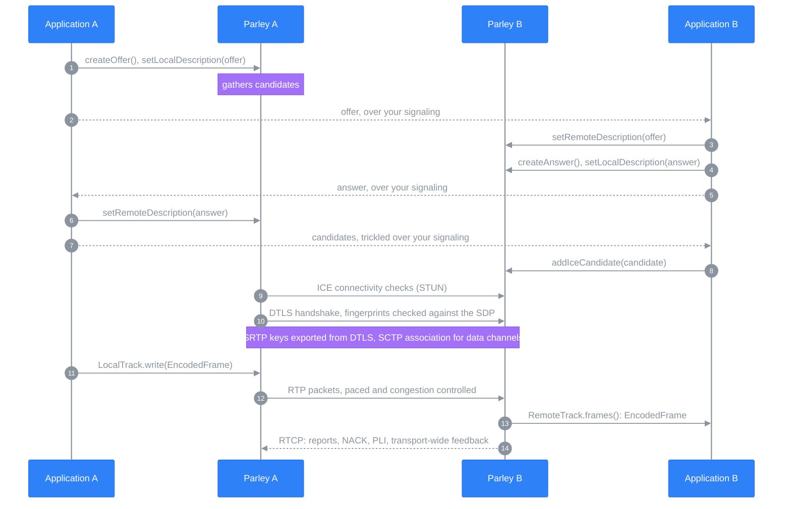
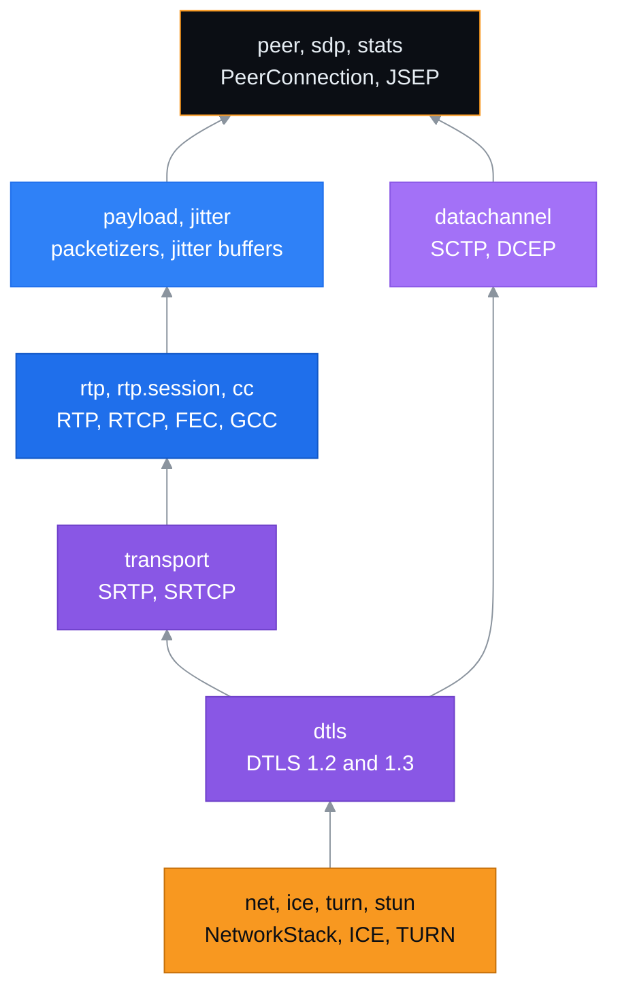

<!-- Link and badge definitions -->
[license]: LICENSE
[issues]: https://github.com/Auties00/Parley/issues
[ci]: https://github.com/Auties00/Parley/actions/workflows/ci.yml
[central]: https://central.sonatype.com/artifact/com.github.auties00/parley
[java26]: https://openjdk.org/projects/jdk/26/
[webrtc]: https://www.w3.org/TR/webrtc/
[jsep]: https://www.rfc-editor.org/rfc/rfc9429.html

[badge-ci]: https://img.shields.io/github/actions/workflow/status/Auties00/Parley/ci.yml?branch=main&style=for-the-badge&label=CI&labelColor=0b0e14
[badge-central]: https://img.shields.io/maven-central/v/com.github.auties00/parley?style=for-the-badge&label=MAVEN%20CENTRAL&color=a371f7&labelColor=0b0e14
[badge-java]: https://img.shields.io/badge/JAVA-26-f89820?style=for-the-badge&logo=openjdk&logoColor=white&labelColor=0b0e14
[badge-license]: https://img.shields.io/badge/LICENSE-MIT-2f81f7?style=for-the-badge&labelColor=0b0e14

<div align="center">


<br/>

[![CI][badge-ci]][ci]
[![Maven Central][badge-central]][central]
[![Java 26][badge-java]][java26]
[![License: MIT][badge-license]][license]

</div>

Parley is a WebRTC endpoint written in Java from the specifications: the [W3C peer connection][webrtc] and its
[JSEP][jsep] offer/answer engine, ICE with STUN, TURN and mDNS, DTLS 1.2 and 1.3 keying SRTP, RTP and RTCP with
retransmission, forward error correction and congestion control, the RTP payload formats of the browser codecs, jitter
buffers, and SCTP data channels. It loads no native code and never touches a codec: your application writes encoded
frames into a track and reads encoded frames (or raw RTP packets) back, so it fits a media server, an SFU, a bot, a
recorder or a SIP bridge equally well, and it talks to Chrome as a peer.

**Contents:** [Features](#features) | [Installation](#installation) | [Quick start](#quick-start) |
[Core concepts](#core-concepts) | [Interop and testing](#interop-and-testing) | [Performance](#performance) |
[Things to keep in mind](#things-to-keep-in-mind) | [Building from source](#building-from-source) | [License](#license)

> [!NOTE]
> Parley is pre-`1.0` and not yet released to Maven Central: the API may still change, and until the first release you
> build it from source (see [Building from source](#building-from-source)).

## Features

**Signaling and the peer connection**

- The W3C `RTCPeerConnection` object model: transceivers, senders, receivers, tracks, `setParameters`, `replaceTrack`,
  `setStreams`, capabilities, transport views, `getStats` with selectors, DTMF and encoded transforms
- JSEP (RFC 9429): offers and answers, the signaling state machine with rollback, implicit `setLocalDescription()`,
  `negotiationneeded`, perfect negotiation, ICE restarts, rejected and recycled m-lines, the SDP edits it allows
- SDP (RFC 8866) as a typed, lossless model: BUNDLE (RFC 8843), ICE and trickle attributes (RFC 8839, 8840), SCTP and
  DTLS attributes (RFC 8841, 8842), fingerprints (RFC 8122), msid (RFC 8830), source attributes (RFC 5576), rid and
  simulcast (RFC 8851, 8853), header extensions (RFC 8285), `b=AS` and `b=TIAS`, `a=tls-id`, `a=cryptex`

**NAT traversal**

- ICE (RFC 8445), full and lite, with host, server-reflexive, peer-reflexive and relayed candidates, trickle, restarts,
  dual-stack pairing (RFC 8421) and consent freshness (RFC 7675)
- ICE-TCP passive and active candidates (RFC 6544) and mDNS host candidates (RFC 6762, draft-ietf-mmusic-mdns-ice-candidates)
- STUN (RFC 8489) messages and client transactions, with OpaqueString passwords (RFC 8265)
- A TURN client (RFC 8656) over UDP, TCP and TLS, with `turn:` and `turns:` URIs (RFC 7065)
- DSCP markings per transport from the senders' network priority (RFC 8837)

**Security**

- DTLS 1.2 (RFC 6347) and DTLS 1.3 (RFC 9147) clients and servers: cookies, retransmission, fragmentation, ECDSA and
  RSA certificates, X25519, AES-GCM and ChaCha20-Poly1305 suites
- DTLS-SRTP keying (RFC 5764) and SDES keying (RFC 4568) of SRTP and SRTCP (RFC 3711) with AES-CM (RFC 3711, 6188) and
  AES-GCM (RFC 7714) profiles, cryptex header encryption (RFC 9335), RTP/RTCP/DTLS/STUN demultiplexing (RFC 7983)

**RTP and RTCP**

- RTP and RTCP (RFC 3550): sender and receiver reports, SDES, BYE, APP, XR receiver reference time and DLRR (RFC 3611),
  reduced-size RTCP (RFC 5506), rtcp-mux (RFC 5761), SSRC collision and loop detection
- Feedback (RFC 4585, 5104): NACK, PLI, FIR, REMB, transport-wide congestion control feedback and RFC 8888 congestion
  control feedback
- Retransmission (RFC 4588), RED (RFC 2198), ULPFEC (RFC 5109) and FlexFEC (RFC 8627)
- Header extensions with one- and two-byte headers: MID, RID and repaired RID, audio level (RFC 6464), CSRC audio
  level (RFC 6465), absolute send time, transport-wide sequence numbers, absolute capture time, playout delay, video
  orientation, and the AV1 dependency descriptor
- Simulcast on send and receive, and forwarding for SFUs with continuous sequence numbers and timestamps across layer
  switches and rewritten VP8 and VP9 picture ids

**Congestion control**

- Google Congestion Control (draft-ietf-rmcat-gcc-02): delay-based and loss-based estimation, acknowledged bitrate,
  probing and congestion-window pushback, fed by transport-wide feedback or RFC 8888
- A pacer, and bitrate allocation across senders within each section's negotiated ceiling

**Payload formats and jitter buffers**

- Opus (RFC 7587), G.711 and G.722 (RFC 3551), comfort noise (RFC 3389) and telephone events (RFC 4733)
- VP8 (RFC 7741), VP9 (RFC 9628), H.264 (RFC 6184), H.265 (RFC 7798), AV1 (the AOM RTP specification) and a generic
  passthrough
- An adaptive audio playout buffer that reports, at each playout instant, the frame to play, the gap to conceal or the
  silence of DTX; a video frame assembler that drives NACK and key frame requests; audio and video synchronisation
  per remote stream

**Data channels**

- Data channels (RFC 8831) and their establishment protocol (RFC 8832) on SCTP (RFC 9260) over DTLS (RFC 8261):
  ordered and unordered, partially reliable (RFC 3758), interleaved (RFC 8260), negotiated ids, stream reset on close
  (RFC 6525), `bufferedAmount` and its low threshold

## Installation

Parley needs Java 26. It is one module, `com.github.auties00.parley`, whose only dependencies are two pure-Java
libraries, `com.github.auties00:srtp` (SRTP and SRTCP protection) and `com.github.auties00:sctp` (the association
under the data channels).

Maven:

```xml
<dependency>
    <groupId>com.github.auties00</groupId>
    <artifactId>parley</artifactId>
    <version>0.1.0</version>
</dependency>
```

Gradle:

```kotlin
implementation("com.github.auties00:parley:0.1.0")
```

In a modular application:

```java
module my.app {
    requires com.github.auties00.parley;
}
```

Parley uses no preview feature, so it needs no `--enable-preview`.

> [!TIP]
> Add `--add-modules jdk.incubator.vector` to the `java` command line. The byte loops of the packet paths (the XOR of
> FEC parity, the search for H.264 and H.265 start codes) then run on the Vector API, about eight times faster for the
> start code search. Without the module, or with `-Dparley.vector=false`, they run scalar code with the same results.
> The JVM prints a one-line warning when it loads an incubator module.

## Quick start

Two peer connections in one JVM, one sending audio to the other. Signaling is your application's job; here it is
a method call, and each side waits for its candidates before handing over its description, as a WHIP or WHEP server
would:

```java
import com.github.auties00.parley.media.EncodedFrame;
import com.github.auties00.parley.media.MediaKind;
import com.github.auties00.parley.peer.Configuration;
import com.github.auties00.parley.peer.LocalTrack;
import com.github.auties00.parley.peer.PeerConnection;
import com.github.auties00.parley.peer.PeerConnectionEvent;
import com.github.auties00.parley.peer.PeerConnectionState;

import java.nio.ByteBuffer;
import java.time.Duration;

public class TwoPeers {
    // 20 ms of Opus silence; in a real application this comes from your encoder
    private static final byte[] OPUS_SILENCE = {(byte) 0xF8, (byte) 0xFF, (byte) 0xFE};

    public static void main(String[] args) throws Exception {
        var timeout = Duration.ofSeconds(10);
        var configuration = Configuration.builder()
                .loopbackCandidates(true)      // both peers live in this JVM
                .build();
        try (var alice = PeerConnection.create(configuration);
             var bob = PeerConnection.create(configuration);
             var bobEvents = bob.events()) {
            var microphone = LocalTrack.audio("microphone");
            alice.addTrack(microphone, "stream");

            // Signaling without trickle ICE: each side gathers its candidates, then hands over its description
            alice.setLocalDescription(alice.createOffer());
            alice.awaitIceGatheringComplete(timeout);
            bob.setRemoteDescription(alice.localDescription().orElseThrow());
            bob.setLocalDescription(bob.createAnswer());
            bob.awaitIceGatheringComplete(timeout);
            alice.setRemoteDescription(bob.localDescription().orElseThrow());

            if (!alice.awaitConnectionState(PeerConnectionState.CONNECTED, timeout)) {
                throw new IllegalStateException("not connected: " + alice.connectionState());
            }

            var remote = bobEvents.stream()
                    .filter(PeerConnectionEvent.Track.class::isInstance)
                    .map(PeerConnectionEvent.Track.class::cast)
                    .findFirst()
                    .orElseThrow()
                    .receiver()
                    .track();

            // One frame every 20 ms on a steady clock, as a capture device delivers them;
            // the RTP timestamp advances by 960 ticks of the 48 kHz Opus clock per frame
            Thread.ofVirtual().start(() -> {
                var start = System.nanoTime();
                for (var index = 0L; index < 100; index++) {
                    var frame = EncodedFrame.of(MediaKind.AUDIO, ByteBuffer.wrap(OPUS_SILENCE), index * 960, true);
                    microphone.write(frame);
                    try {
                        Thread.sleep(Duration.ofNanos(start + (index + 1) * 20_000_000 - System.nanoTime()));
                    } catch (InterruptedException _) {
                        return;
                    }
                }
            });

            try (var frames = remote.frames()) {
                for (var received = 0; received < 50; received++) {
                    var frame = frames.next(timeout).orElseThrow();
                    System.out.println("frame " + frame.rtpTimestamp() + ": " + frame.size() + " bytes");
                }
            }
        }
    }
}
```

A data channel, this time trickling the candidates to the other side as they are gathered:

```java
import com.github.auties00.parley.datachannel.DataChannel;
import com.github.auties00.parley.datachannel.DataChannelMessage;
import com.github.auties00.parley.peer.Configuration;
import com.github.auties00.parley.peer.PeerConnection;
import com.github.auties00.parley.peer.PeerConnectionEvent;

import java.io.IOException;
import java.nio.channels.ClosedChannelException;
import java.time.Duration;

public class Chat {
    public static void main(String[] args) throws Exception {
        var configuration = Configuration.builder()
                .loopbackCandidates(true)
                .build();
        try (var alice = PeerConnection.create(configuration);
             var bob = PeerConnection.create(configuration)) {
            var chat = alice.createDataChannel("chat");

            // The implicit setLocalDescription() creates the offer or answer the signaling state calls for
            bob.setRemoteDescription(alice.setLocalDescription());
            alice.setRemoteDescription(bob.setLocalDescription());

            // Trickle ICE, once each side has the other's description; the first listener of a connection
            // also receives every event raised before it was added, so no candidate is lost
            alice.addListener(event -> {
                if (event instanceof PeerConnectionEvent.IceCandidate(var candidate, var _, var _)) {
                    bob.addIceCandidate(candidate);
                }
            });
            bob.addListener(event -> {
                switch (event) {
                    case PeerConnectionEvent.IceCandidate(var candidate, var _, var _) -> alice.addIceCandidate(candidate);
                    case PeerConnectionEvent.DataChannel(var channel) -> Thread.ofVirtual().start(() -> echo(channel));
                    default -> { }
                }
            });

            chat.awaitOpen(Duration.ofSeconds(10));
            chat.send("hello");
            if (chat.receive() instanceof DataChannelMessage.Text(var reply)) {
                System.out.println(reply);
            }
        }
    }

    // Blocks on receive() until the channel closes; a virtual thread per channel costs next to nothing
    private static void echo(DataChannel channel) {
        try {
            while (true) {
                switch (channel.receive()) {
                    case DataChannelMessage.Text(var text) -> channel.send("echo: " + text);
                    case DataChannelMessage.Binary binary -> channel.send(binary.value());
                }
            }
        } catch (ClosedChannelException | InterruptedException _) {
            // the channel or the connection closed
        } catch (IOException exception) {
            throw new RuntimeException(exception);
        }
    }
}
```

The exchange both examples run, and what happens underneath:



## Core concepts

### The stack

Each layer is an exported package and usable on its own: an `IceAgent` is a datagram transport, `DtlsTransport`
secures any datagram transport, `SrtpTransport` protects RTP on top of it, `RtpSession` runs send and receive streams
over any `RtpTransport`, and `transport.MediaTransport` puts ICE or a plain UDP socket, DTLS-SRTP or SDES keys and
consent freshness together without JSEP, for SIP trunks and services that hand you their own SDP.



### Threading: virtual threads and blocking calls

- Every call that waits blocks the calling thread and takes a `Duration` timeout or can be interrupted:
  `awaitConnectionState`, `awaitIceGatheringComplete`, `DataChannel.awaitOpen` and `receive`, `EventStream.next`.
  Nothing returns a future and nothing takes a callback you must not block in. Run each waiting loop on its own
  virtual thread.
- Events come as sealed hierarchies (`PeerConnectionEvent`, `LocalTrackEvent`, `RemoteTrackEvent`, `DataChannelEvent`)
  you `switch` over, through an `EventStream` (iterable, closeable, one reader) or `addListener`, which calls the
  listener in order on a thread of its own. The first stream or listener of a source also receives what was raised
  before it was opened. A stream holds at most 1,024 events; when the reader falls behind the oldest are dropped and
  counted in `dropped()`, so an unread stream costs bounded memory.
- Parley starts its threads through the `ThreadFactory` of the configuration, virtual threads by default, and the
  socket readers through the `NetworkStack`'s factory. The one exception is the SCTP association's internal threads,
  which the `sctp` library starts itself.
- Encoded transforms (`RtpSender.setTransform`, `RtpReceiver.setTransform`) run on the thread that writes or assembles
  the frame and must not block for long; their output may be handed back from any thread, now or later.

Sending video, with the encoder following the key frame requests and the target bitrate congestion control computes:

```java
var camera = LocalTrack.video("camera");
var cameraEvents = camera.events();
pc.addTrack(camera, "stream");

Thread.ofVirtual().start(() -> {
    try (cameraEvents) {
        for (var event : cameraEvents) {
            switch (event) {
                case LocalTrackEvent.KeyframeRequested _ -> encoder.forceKeyframe();
                case LocalTrackEvent.TargetBitrateChanged(var _, var bps) -> encoder.setBitrate(bps);
                case LocalTrackEvent.EncodingChanged _, LocalTrackEvent.Ended _ -> { }
            }
        }
    }
});

var frame = encoder.nextFrame();
camera.write(EncodedFrame.of(MediaKind.VIDEO, frame, encoder.rtpTimestamp(), encoder.lastWasKeyframe()));
```

### Buffer ownership and zero copy

- An `EncodedFrame` keeps a read-only view of the buffer you pass, from its position to its limit, without copying:
  you hand the bytes over and must not change them afterwards. The packetizers slice that view, so the one copy on
  the send path is the write of each slice into its RTP packet; a packet kept for retransmission is protected from a
  read-only view and SRTP protects it into a reused scratch array instead of copying it into the history.
- A buffer handed to a `PacketReceiver` (the low-level receive callbacks) is valid only during the call; a buffer
  passed to a `send` method may be reused once the call returns.
- What Parley hands out is yours: a `RemoteTrack.Packet` carries a copy of the packet, received frames own their
  bytes, `DataChannel.send(ByteBuffer)` copies the message (the buffer is reusable at once) and
  `DataChannelMessage.Binary` is an immutable read-only view.
- Value types are immutable records, and absent values are `Optional`s.

### Routing through a proxy: the NetworkStack SPI

Every socket Parley opens goes through a `NetworkStack`: UDP endpoints, TCP connections for ICE-TCP and TURN, TLS for
`turns:` servers, listeners and the interface list candidates are gathered on. `NetworkStack.system(threadFactory)` is
the JDK one; implement the interface to tunnel TURN through your own proxy, to pick interfaces, or to simulate loss in
tests. `StreamConnection.startTls(...)` runs TLS over any connected stream, so a tunnel only has to supply TCP:

```java
import com.github.auties00.parley.ice.IceServer;
import com.github.auties00.parley.ice.IceTransportPolicy;
import com.github.auties00.parley.net.DatagramEndpoint;
import com.github.auties00.parley.net.NetworkInterfaceAddress;
import com.github.auties00.parley.net.NetworkStack;
import com.github.auties00.parley.net.StreamConnection;
import com.github.auties00.parley.net.StreamListener;
import com.github.auties00.parley.peer.Configuration;
import com.github.auties00.parley.peer.PeerConnection;

import javax.net.ssl.SSLContext;
import java.io.IOException;
import java.net.InetSocketAddress;
import java.security.GeneralSecurityException;
import java.time.Duration;
import java.util.List;
import java.util.concurrent.ThreadFactory;

/// Sends every TCP connection (TURN over TCP and TLS) through a tunnel, keeping UDP on the system stack.
public record ProxiedNetworkStack(NetworkStack system, Tunnel tunnel) implements NetworkStack {
    /// Opens a connected stream to `target` through a proxy: an HTTP CONNECT, a SOCKS5 handshake, an SSH channel.
    public interface Tunnel {
        StreamConnection open(InetSocketAddress target, Duration timeout) throws IOException;
    }

    public static PeerConnection connect(Tunnel tunnel) {
        var stack = new ProxiedNetworkStack(NetworkStack.system(Thread.ofVirtual().factory()), tunnel);
        return PeerConnection.create(Configuration.builder()
                .iceServers(IceServer.of("turns:turn.example.org:443?transport=tcp", "user", "secret"))
                .iceTransportPolicy(IceTransportPolicy.RELAY)
                .networkStack(stack)
                .build());
    }

    @Override
    public StreamConnection connectTcp(InetSocketAddress remote, Duration timeout) throws IOException {
        return tunnel.open(remote, timeout);
    }

    @Override
    public StreamConnection connectTls(InetSocketAddress remote, String serverName, Duration timeout)
            throws IOException {
        try {
            var tls = SSLContext.getDefault();
            return StreamConnection.startTls(tunnel.open(remote, timeout), tls, serverName, timeout, threadFactory());
        } catch (GeneralSecurityException exception) {
            throw new IOException(exception);
        }
    }

    @Override
    public DatagramEndpoint bindUdp(InetSocketAddress local) throws IOException {
        return system.bindUdp(local);
    }

    @Override
    public StreamListener listenTcp(InetSocketAddress local) throws IOException {
        return system.listenTcp(local);
    }

    @Override
    public List<NetworkInterfaceAddress> interfaceAddresses() throws IOException {
        return system.interfaceAddresses();
    }

    @Override
    public ThreadFactory threadFactory() {
        return system.threadFactory();
    }
}
```

### Codec agnosticism: you supply encoded frames

Parley negotiates codecs (Opus, G.722, G.711, telephone events, VP8, VP9, AV1, H.264 and H.265 by default; the list
is configurable) but never encodes or decodes. You write `EncodedFrame`s whose RTP timestamps are in the negotiated
codec's clock rate (48 kHz for Opus, 90 kHz for video) and optionally attach per-format metadata (`Vp8FrameMetadata`,
`Av1FrameMetadata`, `AudioFrameMetadata`, ...); you read complete, decodable frames in decode order from a remote
track, or, in `RemoteTrackMode.RAW_PACKETS`, every RTP packet as it arrives.

Simulcast writes one frame per layer:

```java
var camera = LocalTrack.video("camera");
pc.addTransceiver(camera, TransceiverInit.builder()
        .direction(TransceiverDirection.SENDONLY)
        .sendEncodings(List.of(
                Encoding.rid("h").withMaxBitrate(2_500_000),
                Encoding.rid("m").withScaleResolutionDownBy(2).withMaxBitrate(800_000),
                Encoding.rid("l").withScaleResolutionDownBy(4).withMaxBitrate(250_000)))
        .build());
camera.write(high, "h");
camera.write(medium, "m");
camera.write(low, "l");
```

An SFU forwards raw packets without decoding them: each subscriber's sender keeps its own SSRC, sequence numbers and
timestamps, continuous across layer switches, maps payload types by codec and header extensions by URI, renumbers VP8
and VP9 picture ids, and holds a new layer back until its next key frame. Retransmission, FEC, pacing and congestion
control stay each subscriber connection's own.

```java
// The publisher's connection delivers raw packets instead of frames
var publisherConfiguration = Configuration.builder()
        .iceLite(true)
        .remoteTrackMode(RemoteTrackMode.RAW_PACKETS)
        .build();

// incoming: the receiver of a publisher's track; subscriber: a subscriber's connection; layer: the rid to forward
var relay = LocalTrack.forwarded("relay", incoming.track().kind());
subscriber.addTrack(relay, "stream");

Thread.ofVirtual().start(() -> {            // forward the selected simulcast layer
    try (var packets = incoming.track().packets()) {
        for (var packet : packets) {
            if (packet.rid().equals(Optional.of(layer))) {
                relay.write(packet);
            }
        }
    }
});
Thread.ofVirtual().start(() -> {            // pass the subscriber's key frame requests on to the publisher
    try (var events = relay.events()) {
        for (var event : events) {
            if (event instanceof LocalTrackEvent.KeyframeRequested) {
                incoming.requestKeyFrame(layer);
            }
        }
    }
});
```

Statistics follow the W3C identifiers and link to each other by id:

```java
var report = pc.getStats();
for (var outbound : report.all(OutboundRtpStreamStats.class)) {
    var rtt = outbound.remoteId()
            .flatMap(id -> report.get(id, RemoteInboundRtpStreamStats.class))
            .stream()
            .flatMapToDouble(remote -> remote.roundTripTime().stream())
            .findFirst();
    System.out.println(outbound.ssrc() + ": " + outbound.packetsSent() + " packets, rtt " + rtt);
}
```

## Interop and testing

The suite has more than 1,300 tests: unit tests, the RFC test vectors of STUN and of the DTLS key schedules and key exchange, randomized and
bounds tests of the wire parsers, DTLS 1.2 and 1.3 handshakes against BouncyCastle, and end-to-end tests of two peer connections over loopback,
covering audio and video, data channels, ICE restarts, TURN over UDP, TCP and TLS through a test TURN server, simulcast,
NACK, RTX and ULPFEC under 5% loss, congestion control under 40% loss and on a 300 kbps bottleneck, ICE-lite, DTLS
restarts, every SRTP profile, DTMF, renegotiation and perfect negotiation.

`ChromeInteropTest` calls headless Chrome for Testing in both directions (Parley offering and Chrome offering), with
DTLS 1.2 and with DTLS 1.3 forced: Parley sends Opus and VP8 frames recorded with WebCodecs, Chrome sends its fake
camera and microphone back, and a data channel exchanges messages. The test checks on Chrome's `getStats` that video
frames decode at the sent size and audio arrives, and on Parley that Opus frames, a VP8 key frame and the channel's
messages arrive.

The [CI workflow][ci] runs on every push and pull request:

- the suite on Linux, Windows and macOS, and once more on the scalar byte kernels
- the Chrome interop test against the stable Chrome for Testing
- the JMH benchmarks with short iterations, failing when the allocation per operation exceeds its recorded baseline
- a release dry run that builds the sources and javadoc jars with doclint on every member

## Performance

Measured with JMH 1.37 on JDK 26 (Windows 11, one fork, `-prof gc`, Vector API enabled), before and after the
optimization pass that made the packet paths zero copy. Allocation per operation is exact; times vary by about 10%
between runs on the shared host.

```mermaid
%%{init: {"theme": "base", "themeVariables": {"xyChart": {"backgroundColor": "transparent", "plotColorPalette": "#8b949e, #2f81f7", "titleColor": "#8b949e", "xAxisLabelColor": "#8b949e", "yAxisLabelColor": "#8b949e", "xAxisTitleColor": "#8b949e", "yAxisTitleColor": "#8b949e", "xAxisLineColor": "#8b949e", "yAxisLineColor": "#8b949e", "xAxisTickColor": "#8b949e", "yAxisTickColor": "#8b949e"}}}}%%
xychart-beta horizontal
    title "Time per operation in ns, before (grey) and after (blue)"
    x-axis ["VP8 packetize", "VP8 depacketize", "H.264 packetize", "H.264 depacketize", "DTLS seal", "SDP serialize", "Video assembler", "Video pipeline"]
    y-axis "ns per operation" 0 --> 13000
    bar [623, 2543, 2428, 4463, 1000, 5638, 4855, 12789]
    bar [163, 598, 707, 1282, 618, 3444, 2465, 10047]
```



The per-packet cost after the pass:

- a 160-byte Opus frame through two RTP sessions over AES-128-GCM SRTP, packetizer to receive stream: 1.3 us and
  3.4 KB allocated; a 5,000-byte VP8 frame: 10.0 us, 21.6 us with ULPFEC in RED
- one Opus packet from `LocalTrack.write` to `RemoteTrack.packets()` between two peer connections over loopback UDP:
  37 us, mostly thread hand-offs and pacing
- parsing an RTP packet: 30 ns (43 ns reading its extensions); writing one with four extensions: 147 ns
- a 5,000-byte frame: VP8 packetized in 163 ns and depacketized in 598 ns; H.264 in 707 ns and 1.3 us; AV1 in 961 ns
  and 4.6 us
- the H.264 start code search over 5,000 bytes: 182 ns with the Vector API against 1,493 ns scalar
- a 1,000-byte DTLS 1.2 AES-GCM record sealed in 618 ns; STUN connectivity checks encoded with MESSAGE-INTEGRITY and
  FINGERPRINT in 1.4 us and verified in 953 ns; a 109-line Chrome offer parsed in 22.9 us and serialized in 3.4 us
- scheduling and releasing one packet through the pacer: 149 ns and 104 bytes

SRTP protection of a 1,200-byte packet takes 613 ns with AES-GCM and 4.2 us with AES-CM and HMAC-SHA1, nearly all of
it inside the `srtp` library and the JCE. The benchmarks live in `jmh/`, outside the library's build:

```sh
mvn -DskipTests install
mvn -f jmh/pom.xml package
java -jar jmh/target/benchmarks.jar -prof gc
```

## Things to keep in mind

- Parley does not capture, encode, decode, render or process media (no echo cancellation or noise suppression); pair
  it with a codec library. `payload.G711` is the one codec helper, a lookup table.
- Signaling is yours: Parley produces and consumes SDP strings and candidates and never sends them anywhere, so WHIP,
  WHEP, SIP or a WebSocket protocol sit on top of it.
- Interop is tested against Chrome. The protocols are the standard ones browsers share, but Firefox and Safari are not
  part of the test suite.
- Not supported, as no browser ships them: Plan B SDP, the identity provider API, TURN over DTLS, TURN TCP allocations,
  ICE-TCP simultaneous open, RTP over QUIC, H.264 interleaved packetization (mode 2), RTCP XR blocks other than
  receiver reference time and DLRR, and the loss-based v2 estimator of libwebrtc (GCC runs the draft's controller).
- A `stuns:` server yields an active TCP server-reflexive candidate only: a passive one would need port-reusing
  connects the `NetworkStack` does not offer. mDNS multicast does not go through the `NetworkStack`.
- Packets an SFU forwards with `LocalForwardedTrack` get retransmission and NACK but no RED or FEC protection, and the
  AV1 dependency descriptor's frame numbers are not rewritten across source switches.
- H.265 de-interleaving across access units (`sprop-depack-buf-nalus` above 0) is not implemented; WebRTC senders do
  not interleave.
- `bufferedAmountLow` and `DataChannel.send(message, timeout)` sample the send buffer every 5 ms, as the `sctp`
  library offers no acknowledgement callback; for the same reason the cause code of an SCTP ABORT is not reported.
  The `sctp` library logs its own association messages through `System.Logger`.
- `media-source` statistics carry no audio level, frame size or frame rate: the local track does not measure them.
- Write frames on a steady clock, as a capture device or an encoder fed by one does; the playout buffer times audio by
  the RTP timestamps, not by when frames arrive.
- Parley logs through `System.getLogger` under the name of the logging class and never logs key material or ICE
  credentials.

## Building from source

With JDK 26 on the path:

```sh
git clone https://github.com/Auties00/Parley.git
cd Parley
mvn install                                         # build, test, install into the local repository
mvn test -Dparley.vector=false                      # the suite on the scalar byte kernels
PARLEY_CHROME=/path/to/chrome mvn test -Dgroups=chrome   # the Chrome interop test
mvn -Prelease -Dgpg.skip -DskipTests verify         # the release artifacts, javadoc linted
```

The Chrome interop test runs only when `PARLEY_CHROME` (or `-Dparley.chrome`) names a Chrome executable, ideally
Chrome for Testing; without one it skips itself.

> [!WARNING]
> The end-to-end tests run real ICE, DTLS and SCTP over loopback sockets with real timers; on a heavily loaded
> machine a timing-dependent test can fail once and pass on a rerun (CI reruns a failed test once).

## License

Parley is released under the [MIT License][license]. Bug reports and pull requests are welcome on the
[issue tracker][issues].
