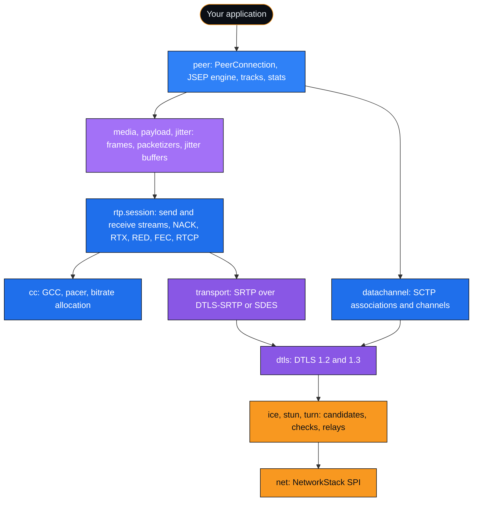

<!-- Link and badge definitions -->
[license]: LICENSE
[issues]: https://github.com/Auties00/Parley/issues
[java26]: https://openjdk.org/projects/jdk/26/
[ci]: https://github.com/Auties00/Parley/actions/workflows/ci.yml
[webrtc]: https://www.w3.org/TR/webrtc/
[jsep]: https://www.rfc-editor.org/rfc/rfc9429.html

[badge-java]: https://img.shields.io/badge/JAVA-26-f89820?style=for-the-badge&logo=openjdk&logoColor=white&labelColor=0b0e14
[badge-license]: https://img.shields.io/badge/LICENSE-MIT-2f81f7?style=for-the-badge&labelColor=0b0e14
[badge-ci]: https://img.shields.io/github/actions/workflow/status/Auties00/Parley/ci.yml?branch=main&style=for-the-badge&label=CI&labelColor=0b0e14
[badge-native]: https://img.shields.io/badge/NATIVE%20CODE-none-a371f7?style=for-the-badge&labelColor=0b0e14

<div align="center">


### A pure-Java, codec-agnostic WebRTC stack for the JVM

[![Java][badge-java]][java26]
[![License][badge-license]][license]
[![CI][badge-ci]][ci]
![No native code][badge-native]

</div>

Parley is a complete WebRTC endpoint written in Java: the [W3C peer connection][webrtc] with its [JSEP][jsep] offer and
answer engine, ICE with STUN, TURN and mDNS, DTLS 1.2 and 1.3 keying SRTP, RTP and RTCP with retransmission, forward
error correction and congestion control, the RTP payload formats of every browser codec, jitter buffers, and SCTP data
channels. It talks to Chrome, Firefox and Safari, and it is a building block for SFUs, bots and recorders.

Parley moves media but never encodes it: you write encoded frames into a local track and read encoded frames (or raw
RTP packets) from a remote one, so any codec fits, including none at all for an SFU that only forwards.

> [!NOTE]
> Parley needs Java 26 and depends only on the JDK and two pure-Java libraries, `srtp` and `sctp`. It loads no native
> code and runs every thread it starts on virtual threads unless you hand it another thread factory.

> [!IMPORTANT]
> Parley is pre-`1.0`: the API may still change between releases.

---

## Quick start

```xml
<dependency>
    <groupId>com.github.auties00</groupId>
    <artifactId>parley</artifactId>
    <version>0.1.0</version>
</dependency>
```

```java
module my.app {
    requires com.github.auties00.parley;
}
```

A peer connection that sends audio and a data channel, with signaling left to your application:

```java
var pc = PeerConnection.create(Configuration.builder()
        .iceServers(IceServer.of("stun:stun.example.org"))
        .bundlePolicy(BundlePolicy.MAX_BUNDLE)
        .build());
var events = pc.events();          // the first stream also gets every event raised before it was opened

var mic = LocalTrack.audio("mic");
pc.addTrack(mic, "stream-1");
var chat = pc.createDataChannel("chat");

var offer = pc.createOffer();
pc.setLocalDescription(offer);
signaling.send(offer.sdp());
pc.setRemoteDescription(JsepDescription.answer(signaling.receive()));

try (events) {
    for (var event : events) {
        switch (event) {
            case PeerConnectionEvent.IceCandidate candidate -> signaling.send(candidate.candidate());
            case PeerConnectionEvent.Track track -> play(track.receiver().track());
            case PeerConnectionEvent.ConnectionStateChanged(var state) when state == PeerConnectionState.FAILED ->
                    pc.restartIce();
            default -> { }
        }
    }
}
```

Every call that waits blocks the calling thread and takes a timeout or can be interrupted; nothing returns a future.
Events arrive in order through an `EventStream` (iterable, closable, bounded) or through `addListener`. A server that
does not trickle candidates (WHIP, WHEP) waits with `pc.awaitIceGatheringComplete(timeout)` before sending its
description, and `pc.awaitConnectionState(PeerConnectionState.CONNECTED, timeout)` tells when media can flow.

---

## Architecture



Each layer is usable on its own: an `IceAgent` is a datagram transport, `DtlsTransport.over(...)` secures any datagram
transport, `SrtpTransport` protects RTP on top of it, and `RtpSession` runs streams over any `RtpTransport`.

---

## Guide

### Data channels

```java
var channel = pc.createDataChannel("files", DataChannelInit.reliable().withOrdered(false));
channel.awaitOpen(Duration.ofSeconds(10));
channel.send("hello");
channel.send(ByteBuffer.wrap(bytes));
DataChannelMessage reply = channel.receive();
```

Channels the peer opens arrive as `PeerConnectionEvent.DataChannel`. A channel created before the first offer, or added
to a connection that so far carried only media, opens once the data section is negotiated and SCTP is up;
`pc.sctp()` then reports the association's state and the largest message it carries.

### Sending encoded media

```java
var camera = LocalTrack.video("camera");
var cameraEvents = camera.events();
pc.addTrack(camera, "stream-1");

Thread.ofVirtual().start(() -> {
    try (cameraEvents) {
        for (var event : cameraEvents) {
            switch (event) {
                case LocalTrackEvent.KeyframeRequested(var rid) -> encoder.forceKeyframe();
                case LocalTrackEvent.TargetBitrateChanged(var rid, var bps) -> encoder.setBitrate(bps);
                case LocalTrackEvent.EncodingChanged(var rid, var encoding) -> encoder.configure(encoding);
                case LocalTrackEvent.Ended() -> { }
            }
        }
    }
});

camera.write(EncodedFrame.of(MediaKind.VIDEO, ByteBuffer.wrap(vp8Frame), rtpTimestamp, keyframe));
```

The track packetizes with the negotiated codec, the pacer spaces the packets out, and congestion control turns the
peer's transport-wide feedback into the target bitrate your encoder receives. Frames written before the sender is
negotiated, or for a layer `setParameters` made inactive, are dropped and counted in `camera.framesDropped()`;
`camera.isSending()` tells whether a frame written now would leave.

### Receiving media

```java
case PeerConnectionEvent.Track track -> Thread.ofVirtual().start(() -> {
    try (var frames = track.receiver().track().frames()) {
        for (var frame : frames) {             // complete, decodable frames in decode order; ends with the track
            decoder.decode(frame);
        }
    }
});
```

For audio, `track.playout()` also streams the gaps to conceal and the silences of DTX, at their playout time, and
`track.events()` raises `Muted`, `Unmuted` and `Ended` as the peer stops and resumes sending.

### Simulcast

```java
var transceiver = pc.addTransceiver(camera, TransceiverInit.builder()
        .direction(TransceiverDirection.SENDONLY)
        .sendEncodings(List.of(
                Encoding.rid("h").maxBitrate(2_500_000),
                Encoding.rid("m").scaleDown(2).maxBitrate(800_000),
                Encoding.rid("l").scaleDown(4).maxBitrate(250_000)))
        .build());

camera.write(highFrame, "h");
camera.write(mediumFrame, "m");
camera.write(lowFrame, "l");
```

### Building an SFU

An SFU receives each publisher's packets raw and forwards them to every subscriber without decoding:

```java
var server = Configuration.builder().iceLite(true);
var publisher = PeerConnection.create(server.remoteTrackMode(RemoteTrackMode.RAW_PACKETS).build());
var subscriber = PeerConnection.create(server.remoteTrackMode(RemoteTrackMode.JITTER_BUFFERED).build());

// once the publisher's track arrives (PeerConnectionEvent.Track)
var incoming = track.receiver();
var relay = LocalTrack.forwarded("relay-" + incoming.track().id(), incoming.track().kind());
subscriber.addTrack(relay, "stream-1");

Thread.ofVirtual().start(() -> {            // forward the selected simulcast layer
    try (var packets = incoming.track().packets()) {
        for (var packet : packets) {
            if (packet.rid().equals(Optional.of(selectedLayer))) {
                relay.write(packet);
            }
        }
    }
});
Thread.ofVirtual().start(() -> {            // pass the subscriber's key frame requests on to the publisher
    for (var event : relay.events()) {
        if (event instanceof LocalTrackEvent.KeyframeRequested) {
            incoming.requestKeyFrame(selectedLayer);
        }
    }
});
```

Each subscriber's sender keeps its own SSRC, sequence numbers and timestamps, continuous when the forwarded layer
changes; it maps the payload type by codec and the header extensions by URI, renumbers the VP8 and VP9 picture ids, and
holds a new layer back until its next key frame, asking for one. Retransmission, FEC, pacing and congestion control are
the subscriber connection's own.

### Routing through a proxy

Every socket goes through a `NetworkStack`. Implement it to send TURN over your own proxy or tunnel; TLS for `turns:`
servers can run on top of your TCP connections with `StreamConnection.startTls(...)`.

```java
var pc = PeerConnection.create(Configuration.builder()
        .iceServers(IceServer.of("turns:turn.example.org:443?transport=tcp", "user", "secret"))
        .iceTransportPolicy(IceTransportPolicy.RELAY)
        .networkStack(new ProxiedNetworkStack(proxy))
        .build());
```

### Statistics

```java
StatsReport report = pc.getStats();
for (var outbound : report.all(OutboundRtpStreamStats.class)) {
    var remote = outbound.remoteId().flatMap(id -> report.get(id, RemoteInboundRtpStreamStats.class));
    System.out.println(outbound.rid() + " " + outbound.packetsSent() + " packets, rtt "
            + remote.flatMap(RemoteInboundRtpStreamStats::roundTripTime));
}
```

`sender.getStats()` and `receiver.getStats()` return only the objects that stream references.

<details>
<summary>More: DTMF, end-to-end encryption, perfect negotiation, SDP</summary>

DTMF, as RFC 4733 events on the audio stream:

```java
sender.dtmf().orElseThrow().insertDtmf("1234#", Duration.ofMillis(100), Duration.ofMillis(70));
```

An encoded transform runs on every frame before packetization and after assembly, which is where SFrame-style
encryption goes:

```java
sender.setTransform(frame -> frame.withData(sframe.encrypt(frame.data())));
receiver.setTransform(frame -> frame.withData(sframe.decrypt(frame.data())));
```

Perfect negotiation works as written for browsers: a remote offer applied over a pending local offer rolls it back, and
`setLocalDescription()` creates the right description for the signaling state.

```java
case PeerConnectionEvent.NegotiationNeeded() -> signaling.send(pc.setLocalDescription());
```

Session descriptions are a typed, lossless model you can inspect or edit before applying, within the edits RFC 9429
allows:

```java
var sdp = SessionDescription.parse(offer.sdp());
for (var rtpmap : sdp.media().getFirst().attributes(SdpAttribute.Rtpmap.class)) {
    System.out.println(rtpmap.payloadType() + " " + rtpmap.encodingName());
}
```

</details>

<details>
<summary>Without a peer connection: SIP trunks and SDES</summary>

`transport.MediaTransport` runs one RTP session's transport without JSEP: ICE or a plain UDP socket, DTLS-SRTP or SDES
keys from `a=crypto`, consent freshness and failure events. It suits SIP trunks and services that hand you their own
SDP, while `RtpSession` and the payload formats work on top of it as usual.

</details>

<details>
<summary>Specifications</summary>

- W3C: WebRTC 1.0, WebRTC Statistics, WebRTC Extensions, Scalable Video Coding, Encoded Transform, Media Capture and
  Streams (track model)
- Signaling: RFC 8866 (SDP), RFC 9429 (JSEP), RFC 8843 (BUNDLE), RFC 8839 and 8840 (ICE and trickle in SDP), RFC 8841
  and 8842 (SCTP and DTLS in SDP), RFC 8122 (fingerprints), RFC 8830 (msid), RFC 5576 (source attributes), RFC 8851
  and 8853 (rid and simulcast), RFC 8285 (header extensions), RFC 4568 (SDES)
- NAT traversal: RFC 8445 (ICE, full and lite), RFC 8489 (STUN), RFC 8656 (TURN over UDP, TCP and TLS), RFC 7675
  (consent freshness), RFC 6544 (ICE-TCP), RFC 8421 (dual stack), mDNS host candidates
- Security: RFC 6347 and RFC 9147 (DTLS 1.2 and 1.3), RFC 5764 (DTLS-SRTP), RFC 3711, 7714 and 6188 (SRTP with
  AES-CM and AES-GCM), RFC 9335 (cryptex), RFC 7983 (demultiplexing)
- Media: RFC 3550 (RTP and RTCP), RFC 4585 and 5104 (feedback), RFC 4588 (RTX), RFC 2198 (RED), RFC 5109 and 8627
  (FEC), RFC 5506 (reduced-size RTCP), RFC 3611 (XR), RFC 8888 (congestion control feedback), transport-wide
  congestion control and GCC, REMB, RFC 8837 (DSCP markings)
- Payload formats: Opus (RFC 7587), G.711 and G.722 (RFC 3551), comfort noise (RFC 3389), telephone events (RFC
  4733), VP8 (RFC 7741), VP9 (RFC 9628), H.264 (RFC 6184), H.265 (RFC 7798), AV1 with the dependency descriptor
- Data: RFC 8831, 8832 and 8261 (data channels, DCEP, SCTP over DTLS), RFC 9260, 8260, 3758 and 6525 (SCTP)

</details>

---

## Things to keep in mind

- Parley does not capture, encode, decode or render media; pair it with a codec library.
- DTLS 1.3 is verified against itself, the RFC test vectors and Chrome for Testing 158, which negotiates it when both
  sides offer it; DTLS 1.2 interop is tested by restricting Parley to 1.2.
- Parley starts every thread through the configuration's `ThreadFactory`, except the SCTP association's internal
  threads, which the `sctp` library starts itself.
- Plan B SDP, the identity provider API, TURN over DTLS and RTP over QUIC are not supported, as no browser ships them.
- The interop test against Chrome (tagged `chrome`) runs only when `PARLEY_CHROME` (or `-Dparley.chrome`) names a
  Chrome executable, Chrome for Testing in CI: `PARLEY_CHROME=/path/to/chrome mvn test -Dgroups=chrome`.

## License

Parley is released under the [MIT License][license]. Bug reports and pull requests are welcome on the
[issue tracker][issues].
